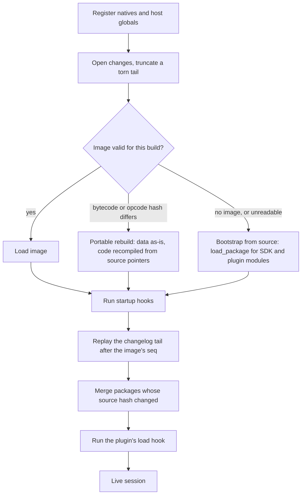

# Steel no-kernel images and changelog: implementation plan

Status: plan, not implemented. Last updated 2026-10-24.

## Goal and scope

After a restart, a Yinz Steel engine should come back with every definition and global change made at runtime through the REPL or a plugin, the way a Squeak/Pharo image does. In Squeak, an `.image` holds a snapshot of the heap, and an append-only `.changes` file logs every accepted method and do-it. On startup the image loads, and "recover lost changes" replays any log entries written after the last save.

For Steel, that model maps onto two files per persistent engine:

- **Changelog** (`*.changes`): an append-only, checksummed log of every top-level form evaluated through a recorded entry point. Each entry carries a sequence number, a timestamp, its origin (REPL, a plugin by name, or the host), and the module it was evaluated in. It is the journal: each entry is written before its form runs, and the log covers everything the newest image does not.
- **Snapshot** (`*.image`): a versioned capture of the engine's whole Scheme-level heap as of one changelog sequence number: every global, closure, struct type, module, and macro, including the SDK and plugin code. Natives are not in it. They are re-bound by name on load, the way a Squeak image re-binds VM primitives. Restoring an engine means loading the image, running startup hooks, and replaying the changelog tail.

**In scope:** no-kernel engines from `Engine::new_raw_no_kernel()`. That covers `define` and redefinition, `set!` on globals, `struct` / `define-values` lowered natively, runtime `require` of modules, and the data held in globals.

**Non-goals:**

- Kernel mode, `defmacro`, and `begin-for-syntax` (see AGENTS.md).
- In-flight execution state: threads, continuations, and pending futures. Snapshots are taken only at quiescent points, between top-level forms.
- OS resources: ports, sockets, child processes, and Rust `Custom` values with no registered serializer. These get explicit re-acquire hooks instead.
- Bytecode compatibility across Steel versions. A version mismatch falls back to rebuilding from source.
- A Smalltalk-style IDE (change sorters, version browsers). This plan only provides the data a browser would need.

## Current state

Steel already has relocatable value serialization that a snapshot can build on. But it has three blockers: redefinition does not reach existing callers, global names are not stable across processes, and the serializer panics on values it cannot handle. On the Yinz side, every plugin engine and every REPL session is thrown away on reload, and the REPL cannot reach a plugin's engine.

### Steel (this repo)

| Area | What exists | Why it matters |
| --- | --- | --- |
| Evaluation entry | All evals go through `Compiler::compile_executable` → `Engine::run_raw_program` (`steel_vm/engine.rs:1803-1917`). | One choke point to hook recording. |
| Global env | Globals are slots in `SymbolMap` (`compiler/map.rs:85`), and bytecode addresses them by slot index (`PUSH`, `CALLGLOBAL*`). | Slot indices depend on registration order, so they can't be persisted. |
| Redefinition | `SymbolMap::add` gives a redefined name a **new** slot and shadows the old one (`map.rs:141-178`). A probe in a no-kernel engine showed `(define (bar) 1) (define (foo) (bar)) (define (bar) 2) (foo)` → `1`, while `set!` is seen by callers. | REPL edits don't reach already-compiled callers, which is the opposite of Smalltalk. Name-based restore also can't represent a shadowed slot. |
| Value serde | `serialize-value` / `deserialize-value` (`steel_vm/vm/threads.rs:333-600`) serialize closures as bytecode plus constants and captures. Global references are recorded by name (`symbol_index_map`) and re-linked through `global_mapping` (`values/functions.rs:293-370`). Natives are stored as `NativeRefSpec {module, key}`, and struct types as `SendableVTableEntry`. | This is about 70% of a heap serializer, and it already relocates slot and constant indices. |
| Serde gaps | `panic!()` for unresolvable `BoxedFunction`s (`rvals.rs:1424`), `.expect` on native refs (`rvals.rs:1386`), `todo!()` in cycle patching (`threads.rs:429-450`). Struct types must already exist in the receiving engine (`threads.rs:372`). | It must be made total, returning errors instead of panicking, and must be able to recreate struct types. |
| Mangled names | Module globals are named `##mm<interner-id>__%#__name` (`compiler/modules.rs:997-1020`). The interner id differs between processes. Lifted lambdas (`##lambda-lifting…`) and generated names use per-process counters. | Snapshots must canonicalize them to `(module-path, name)` and reallocate generated names on restore. |
| Compiler state | `Compiler` holds `symbol_map`, `constant_map`, `macro_env`, `module_manager`, `function_ids` (Yinz GC patch), `sources`, and more (`compiler/compiler.rs:427`). A partial `SerializableCompiler` exists (`compiler.rs:461`). | A restored engine must have these, so later REPL forms compile against the restored bindings. |
| Prior art | `NonInteractiveProgramImage` and a commented-out `StartupBootstrapImage` (`engine.rs:297-343`) serialize compiled *programs*, not runtime state. | Useful for the image framing; not reusable for heap state. |

Groundwork that makes a *full* heap image realistic:

- **Heap traversal:** `BreadthFirstSearchSteelValReferenceVisitor` (`rvals/cycles.rs:1804`) already visits every `SteelVal` variant, including closures, structs, heap cells, continuations, futures, and custom values. An identity-preserving object-graph writer can sit on top of it.
- **Compiler state is mostly serde-ready:** `CompiledModule` (`compiler/modules.rs:981`), `ExprKind` (`steel-parser/src/ast.rs:125`), and `SteelMacro` (`parser/expander.rs:155`) derive `Serialize`. `ModuleManager` (`modules.rs:250`) and `SymbolMap` don't yet.
- **The interner can be pre-seeded:** it is one global `ThreadedRodeo`, and `initialize_with` (`steel-parser/src/interner.rs:141`) installs a prepared one. Yinz runs each engine in a fresh process, so an image's string table can be installed before anything else interns.
- **Modules know when they are stale:** `ModuleManager` recompiles a module when its source or a dependency changes (`modules.rs:2316-2341`). That is the hook for loading a new plugin version into a live image.
- **Gaps a full image adds:** the current serializer copies shared immutable values (identity is kept only for `HeapAllocated` cells), so `eq?` sharing and DAG size are lost. The function interner, constant map, and thread-local storage on `SteelThread` (`steel_vm/vm.rs:390-424`) are also roots, and none of them are serialized today.

### Yinz (`~/yinz`)

- **One engine per plugin instance, each in its own child process.** `sandbox.rs:22` creates the engine. `WorkerRuntime::new` spawns `yinz --steel-runtime-worker` (`worker/client.rs:63-110`), which runs a JSON operation loop (`worker/protocol.rs:22-38`, `worker/server.rs`).
- **Boot order:** natives and pure modules (`sandbox.rs:20-107`), then the SDK `.scm` files through `engine.run` (`lib.rs:322-357`), then the plugin body through `emit_raw_program_with_source_name` + `run_raw_program` (`lib.rs:513-537`), then the `load(config)` hook (`steel/mod.rs:305-334`).
- **Reload always builds a fresh engine** and kills the old process (`plugin_bridge.rs:1171,1492`, `steel/mod.rs:429-541`). No Steel state survives a reload or a restart.
- **The REPL is a private, throwaway plugin** (`yinz:repl` with a random `_yinz_id`, `yinz-client/src/repl.rs:44-99`). It evaluates with host access *on* (`steel/repl.rs:7-67`) and cannot target another plugin's engine.
- **Side-effect boundary:** the module body runs with host commands disabled (`steel/mod.rs:141,197`). Keybindings, palette entries, timers, and data watches are only registered from `load` and later. That makes "after the body, before `load`" a safe point to restore and replay.
- **Existing durable storage:** the SQLite plugin-data store (`<data dir>/plugin-data.db`) and `/cache` under `YINZ_CACHE_DIR`. Yinz does not use Steel value serialization today.

## Design options

**Recommendation: build toward a true full heap image from the start, as Squeak does.** The image holds the whole Scheme world, including the SDK and plugin code. Natives are re-bound by name, the changelog is the journal between images, and plugin upgrades load new source *into* the image, the way Monticello does. Each obstacle that seemed to rule a full image out has a Squeak-shaped answer:

| Obstacle | Squeak's answer | Steel / Yinz design |
| --- | --- | --- |
| Native functions and Rust code | The image references VM primitives by name or number. The VM is not in the image. | Natives are the "VM". The host registers them before load, and the image refers to them as `NativeRefSpec {module, key}`, which already exists. A missing native is a load error naming it. |
| `Custom` values, ports, sockets, OS handles | `startUp:` / `shutDown:` lists re-open external resources. | Types with a registered serializer (`values/serde.rs`) round-trip. All others save as a `#<dead-handle type>` placeholder. A Scheme-level startup list (`register-startup-hook!`) re-acquires them. Host globals such as `yinz-command` and `%rpc-prefix` are linked by name and never stored, so they are fresh on every boot. |
| Slot indices and interner ids vary between processes | The object memory is relocated on load. | Every global and symbol is written by canonical name or by its string-table entry, and relinked on load through the existing `global_mapping` / constant remapping. |
| Bytecode is tied to the Steel build | An image is tied to its VM format, and a new format means a bootstrap. | The header records the Steel build and opcode-table hash. On a mismatch, run a *portable rebuild*: data values (no bytecode) load as-is, code recompiles from its source pointers (plugin source and changelog), and a new image is written. |
| Plugin and SDK upgrades would freeze | New code is loaded into the running image, class variables keep their values, and instances migrate when a class's shape changes. | The Plugin and runtime upgrades section below: diff by definition, redefine in place, keep data, migrate struct instances, then run an `on-upgrade` hook. |
| In-flight threads and continuations | The process state is saved too. | Not saved. Snapshots happen only between worker operations. Continuations, futures, and thread handles in globals become dead handles, and startup hooks clean them up. |

The hybrid overlay from the first draft is just a *root policy* of the same serializer ("only slots changed since the base mark"), so nothing in this design rules it out. The difference that matters is upgrades. With a full image, the plugin body does **not** rerun at boot, so a new plugin version must be *merged* into the image instead of replacing the engine.

## Proposed architecture

Each persistent engine has one directory holding an append-only `changes` file and up to N numbered full images. Restore = register natives, load the newest valid image, run startup hooks, replay the changelog tail, and merge any changed packages.

### Persistence unit and layout

A *persistent environment* is a stable identity: a plugin's id, or a named REPL workspace. It is never a generation or a process.

```
<yinz data dir>/steel-images/<env-id>/
  changes          append-only changelog (text, valid Scheme)
  image.000041     snapshot covering changes up to seq 41
  image.000057     newest snapshot (keep the last 3)
  LOCK             single-writer lock
```

### Changelog format

Each entry is a block-comment header followed by the exact source evaluated, so the whole file stays readable and loadable Scheme, like Squeak's chunk format. A second, outcome entry is appended after evaluation finishes.

```scheme
#|@change seq=57 ts=2026-10-24T14:03:11Z origin=repl:workspace/main module=#f kind=define names=(render-row) len=88 crc=9f31c2aa|#
(define (render-row r)
  (string-append (row-title r) " — " (row-status r)))
#|@outcome seq=57 ok|#
```

- **Fields:** `origin` is `repl:<session>`, `plugin:<id>`, or `host`. `module` is the canonical module path to evaluate in, or `#f` for top level. `kind` comes from the expanded form: `define`, `syntax`, `struct`, `require`, `set`, or `doit`. `names` lists the bindings the form introduces or assigns.
- **Write-ahead:** an entry is appended and flushed *before* evaluation. The outcome is `ok`, `error <msg>`, or `host-effect` (the form called `yinz-command`). An entry with no outcome means a crash during evaluation.
- **Snapshot markers:** `#|@snapshot seq=57 file=image.000057 sha256=…|#` records which entries an image covers.
- **Integrity:** `len` + `crc` per entry. A torn final entry is truncated on open and reported, never silently replayed.

### Image format

The image is a versioned bincode blob, `ImageV1`. It holds everything reachable from the engine's roots, with every object written once under an image-local id, so sharing, `eq?`, and cycles survive.

| Section | Contents |
| --- | --- |
| Header | Magic, format version, Steel build and opcode-table hash, the changelog seq it covers, and a **native manifest hash** (the sorted `(module, key)` list the image links against). |
| String table | Every string the image uses (symbols, canonical global names, module paths), keyed by image-local id and re-interned on load. Pre-seeding the interner with `initialize_with` is an optional fast path. |
| Object graph | Closures (bytecode, arity, captures, constants by id, defining source pointer), pairs, lists, vectors, hashes, strings, struct instances, and heap cells. Natives are `NativeRefSpec` and unserializable values are dead handles. |
| Roots | Global slots in slot order (canonical name → object id), the constant map, the function interner (closure and pure-function prototypes), thread-local storage, and the startup and shutdown hook lists. |
| Compiler state | Symbol map (canonical names, shadowed slots included), `ModuleManager` (`CompiledModule` ASTs, prefixes, requires, provides), `macro_env`, struct vtable entries with layout hashes, `function_ids`, and the `Sources` text needed for error spans. |
| Package table | One entry per package (the SDK, each plugin module, each REPL workspace): source hash and version. Per binding: the definition hash it was loaded from, its origin, a **dirty** flag (changed since load), and a source pointer. The upgrade merge runs on this table. |
| Dead handles | Type name and global path for each placeholder, so the restore report can say what needs re-acquiring. |

### Restore sequence

Plugin source runs at boot only to bootstrap or upgrade:



In the normal case no Scheme source runs at boot. The plugin body runs only to bootstrap (no image) or as part of a package merge. A restore error never blocks plugin load: it falls back to the portable rebuild, then to bootstrap, and reports why.

### Snapshot triggers and compaction

- **Triggers:** an explicit save (`(image-save)`, `yinz image save`), graceful shutdown or plugin reload, and an idle timer once more than K changes have accumulated since the last image. Snapshots only run between operations in the worker loop, which is a natural safepoint.
- **Atomic write:** write `image.tmp`, fsync, rename, then append the `@snapshot` marker. A crash at any step leaves the previous image valid.
- **Condense** (Squeak `condenseChanges`): rewrite `changes` to keep only the newest `define`-family entry per name plus entries after the newest image. Run it on demand only, since full history is cheap and makes reverts possible.

## Plugin and runtime upgrades

An upgrade loads new source *into* the live image, the way Monticello does:

- Definitions are diffed by name.
- Code is redefined in place, so every existing caller and closure sees it.
- Data keeps its value, and struct instances migrate to the new shape.
- Local edits win over upstream changes unless the user picks otherwise.

Upgrade-at-boot and live reload use the same merge.

### Packages and load records

- A **package** is a unit of source with one owner: `sdk` (the Yinz SDK `.scm` files built into the binary), `plugin:<id>/<module path>` (each module in a plugin tree), or `workspace:<name>`.
- Loading a package writes a **load record** per top-level definition: name, kind (`procedure`, `syntax`, `struct`, `data`), **definition hash** (the expanded form with spans stripped), and the value identity the load produced.
- An `eval_recorded` that redefines or assigns a package-owned name marks it **dirty** and records the changelog seq, like Monticello's "modified" marker. At merge time, a slot whose value identity no longer matches its load record also counts as dirty, which catches `set!` from plugin code.

### Merge rules

The merge expands the new source without running it, then classifies every name in the old and new sets:

| Upstream change | Local state | Procedures, syntax, structs | Data |
| --- | --- | --- | --- |
| Unchanged | Clean | Nothing to do. | Keep the current value. The right-hand side does not rerun. |
| Unchanged | Dirty | Keep the local edit. | Keep the current value. |
| Changed | Clean | Redefine in place from upstream. | Rerun the new right-hand side, unless the name is `define-persistent`. Then keep the value and pass it to `on-upgrade`. |
| Changed | Dirty | **Conflict.** Keep local by default and report both sources. `yinz image resolve <name> --take upstream\|local` settles it. | Keep the current value and report it. |
| Added | n/a | Define. | Evaluate the right-hand side. |
| Removed | Clean | Unbind if no live closure references the slot. Otherwise keep it as an orphan and warn. | Same as procedures. |
| Removed | Dirty | Keep it and report a conflict. | Keep it and report it. |

- **Apply order:** struct types, then syntax, then procedures, then data, all through `compile_in_module` with `RedefinitionMode::InPlace`. Data right-hand sides run last, so they see the new code.
- **In-place mutation:** contents mutated in place, such as a mutable vector or a box held in a global, don't change slot identity. State like that should use `define-persistent`, which never reruns its right-hand side once a value exists.
- **Struct shape changes:** when the layout hash is unchanged, keep the descriptor and rebind the constructor, predicate, and accessors in place. When it changed, create a new descriptor and migrate every existing instance by field name. Kept fields copy over, new fields come from the plugin's `(struct-migration name (lambda (old) …))` or default to `#f`, and dropped fields are discarded.
  - Migration happens during image deserialization, which already constructs every instance, so a shape change acts as Squeak's `become:` without a live heap walk.
  - A live upgrade that changes a shape therefore goes through save → worker restart → load with a migration map.
- **Hooks:** after the merge, call the package's `(on-upgrade old-version new-version)` if defined, with host access off. Then the normal `load` runs.

### Live upgrade sequence

1. Call the old generation's `unload` hook. The host clears its keybindings, palette entries, watches, and timers, as `dispose_generation` does today (`steel/mod.rs:494-517`).
2. Save a **pre-upgrade image** (`image.N.pre-upgrade`).
3. Merge. If any struct shape changed, restart the worker and load the pre-upgrade image with the migration map, then merge the rest.
4. Call `on-upgrade`, then `load`, then save a new image.
5. On any error, reload the pre-upgrade image, report the failure, and keep running the old version. `yinz image revert --upgrade` also rolls back a merge that succeeded.

### SDK and Steel upgrades

- **Yinz SDK:** package `sdk` merges by the same rules on the first boot of a new Yinz binary.
  - New natives just appear.
  - If a native the image references was removed, that reference loads as a dead handle that errors with the native's name, and the SDK merge normally redefines its callers.
- **Steel bytecode change (portable rebuild):**
  - Pure data loads unchanged.
  - Top-level code recompiles from its source pointer: current package source for clean bindings, changelog source for dirty ones.
  - Closures with captures that are stored inside data (a callback list, say) have no source of their own. They load as dead handles, the report lists them, and the plugin's startup hook re-registers them.

## Required Steel changes

The work goes in a new `steel_vm/image/` module (`changelog.rs`, `graph.rs`, `image.rs`, `merge.rs`) plus fixes in the compiler and serializer. All of it is no-kernel only and opt-in per engine.

### Prerequisites (semantics)

1. **Redefinition in place.** Add an engine option, `RedefinitionMode::InPlace`, under which a `define` of an already-bound name reuses the existing slot instead of shadowing it (`SymbolMap::add`, `map.rs:141-178`). Both live editing and the upgrade merge depend on it.
   - Audit everything that bakes a global into bytecode: `CALLGLOBALNOARITY` arity specialization (`compiler/program.rs:440-495`), `const_evaluation.rs`, lambda lifting, and `CALLPRIMITIVE` under `jit2`.
2. **Canonical global names.** Map `##mm<interner-id>__%#__name` ↔ `Module(path, name)` through `path_to_prefix_name`. Give generated names (`##lambda-lifting…`, `##__lifted_pure_function…`, `define-values` temporaries) image-local ids that are renamed on load.
3. **Total serializer.** Replace the `panic!()`, `.expect`, and `todo!()` paths (`rvals.rs:1366-1460`, `threads.rs:333-460`) with `Err(Unserializable { path, type_name })`. In an image, that error becomes a dead handle.
4. **Recreatable struct types.** Add field count and a layout hash to `SendableVTableEntry`, plus `VTable::get_or_create_by_sendable_entry`. Struct types are process-global (`STATIC_VTABLE`), so the image carries the entries this engine created and recreates them on load.

### Full-image machinery

5. **Identity-preserving object graph** (`graph.rs`): a writer built on `BreadthFirstSearchSteelValReferenceVisitor` that keeps a pointer → id table for every `Gc` type, not just `HeapAllocated`, and a two-phase reader that allocates first and patches cycles second. `serialize-value` can then be rebuilt on top of it.
6. **Root enumeration:** global slots (shadowed ones included), `constant_map`, `function_interner`, `thread_local_storage`, this engine's vtable entries, and any roots registered by the Yinz heap patches. Rooting must follow the same rules the GC uses (`with_heap`, `function_ids`), so restored closures are collected the same way compiled ones are.
7. **Compiler state:** derive or write `Serialize` for `SymbolMap` (canonical names plus free list), `ModuleManager`, and the compiled-module cache. Add `Compiler::from_image`. Analysis caches are recomputed, not stored.
8. **Startup and shutdown hooks plus dead handles:** a builtin module providing `register-startup-hook!`, `register-shutdown-hook!`, and `dead-handle?`. A dead handle is a struct that records the type name and global path, and raises a clear error when called or used.
9. **Load records and the package table:** record name, kind, and definition hash for each top-level definition during the native lowering in `parser/expand_visitor.rs`.
10. **Merge engine** (`merge.rs`): expand without running, classify (Merge rules table), apply in order, `define-persistent` lowering, and `struct-migration` support in the deserializer.
11. **Portable rebuild:** recompile each top-level binding from its source pointer when the opcode-table hash differs.

### New engine API

```rust
pub enum Origin { Repl(String), Plugin(String), Host }
pub struct PackageId(String); // "sdk", "plugin:<id>/<module>", "workspace:<name>"

impl Engine {
    pub fn set_redefinition_mode(&mut self, mode: RedefinitionMode);
    /// Bootstrap path: load a package from source and write its load records.
    pub fn load_package(&mut self, pkg: PackageId, src: &str, version: &str) -> Result<()>;
    /// Write-ahead log, classify, evaluate, mark dirty, log the outcome.
    pub fn eval_recorded(&mut self, src: &str, module: Option<&Path>, origin: Origin,
                         log: &mut ChangeLog) -> Result<Vec<SteelVal>>;
    pub fn save_image(&mut self, log: &ChangeLog) -> Result<(ImageV1, SnapshotReport)>;
    /// Natives must already be registered. Covers the load and portable-rebuild paths.
    pub fn from_image(natives: NativeSet, image: &ImageV1, sources: &dyn SourceLookup)
                      -> Result<(Engine, RestoreReport)>;
    pub fn run_startup_hooks(&mut self) -> Result<HookReport>;
    pub fn replay(&mut self, log: &ChangeLog, after_seq: u64, filter: ReplayFilter)
                  -> Result<ReplayReport>;
    pub fn merge_package(&mut self, pkg: PackageId, src: &str, version: &str,
                         policy: &MergePolicy) -> Result<MergeReport>;
}
```

- **Evaluating in a module scope:** `eval_recorded` and `merge_package` need a no-kernel `Compiler::compile_in_module(path, exprs)` that resolves free identifiers against the module's mangled prefix and its requires. No public API does this today.
- **Native manifest:** `NativeSet` is the sorted `(module, key)` list the host registered. The image's manifest hash is checked against it, and every mismatch is named in the report.
- A standalone `steel --image <dir>` mode in `crates/steel-repl` serves as a Yinz-free harness for every test.

## Required Yinz changes

Yinz owns the identities, the files, and the triggers. Steel owns the formats, restore, and merge. The biggest Yinz change is that with persistence on, **a reload upgrades the existing engine instead of replacing it**.

- **Split boot into natives and Scheme** (`sandbox.rs:20-107`, `lib.rs:149-365`). `Runtime::new` registers only natives and host globals. The SDK `engine.run` calls (`lib.rs:322-357`) become `load_package("sdk", …)`, which runs only on the bootstrap path.
  - Host globals registered with `Engine::register_value` / `register_fn` (`yinz-command`, `%rpc-prefix`, ports, clocks) go into the native manifest by name, so the image links to them and never stores their values.
- **Plugin boot** (`yinz-plugin-host/src/steel/mod.rs:197-205`): replace the unconditional `eval_with_path` with the restore flow. Load the image with `from_image`, or bootstrap by calling `load_package` for each plugin module. Then run startup hooks and the changelog replay, merge if a package hash differs, and call `load`. Everything before `load` stays inside `with_runtime(false, …)`.
- **Reload becomes a live upgrade** (`plugin_bridge.rs:1171,1492`, `plugin_loader.rs:308-310`): follow the live upgrade sequence in the same worker instead of `dispose_generation` plus a fresh process. The fresh-process path remains for `persist false`, for rollback, and for struct-shape migrations.
- **SDK async state** (`async.scm`, `rpc.scm`): pending futures and RPC tables hold host request ids that die with the process. A shutdown hook drains them, and a startup hook rejects any that survived with a "host restarted" error.
- **Worker protocol** (`worker/protocol.rs:22`, `worker/server.rs:52`): add `OpenImage`, `EvalRecorded`, `SaveImage`, `MergePackage`, `ImageStatus`, and `Condense`, returning Steel's reports as JSON.
- **Host-effect tagging** (`lib.rs:200`, `yinz-command`): set a per-eval flag when a host command fires, so the changelog outcome is `host-effect` and replay skips that form.
- **Package sources:** hash each plugin module as it is resolved over `SourceRequest` (`modules.rs:496-575`). The SDK's hash is fixed at build time. The plugin version comes from its manifest and is passed to `on-upgrade`.
- **REPL targets** (`yinz-client/src/repl.rs:44-99`, `steel/repl.rs:7-67`):
  - `yinz repl --workspace <name>`: a persistent environment (package `workspace:<name>`). The default REPL stays ephemeral.
  - `yinz repl --attach <plugin> [--module <path>]`: route evals to that plugin's engine with `origin=repl:<session>`, gated by the plugin's permissions.
- **Snapshot triggers:** graceful shutdown, after every merge, an idle timer, and an explicit save. Snapshots run only between worker operations.
- **Storage:** `<data dir>/steel-images/<env-id>/` from `yinz-runtime/src/home.rs:38-51`. Background workers (`steel/workers.rs:28`) are excluded in v1.
- **CLI:** `yinz image status|save|list|changes [--name f]|resolve <name> --take upstream|local|revert <seq>|revert --upgrade|condense|discard <env>`. Reverts append new changelog entries, so history stays append-only.
- **Disable switch:** per-plugin `persist false`, a global config key, and `YINZ_NO_IMAGES=1` for a clean bootstrap.

## Implementation phases

There are six phases, and the full image works end to end in Steel by Phase 2. Each phase ships alone and depends only on the ones before it. Upgrades come right after the Yinz boot change, because once plugin bodies stop running at boot, a plugin edit only reaches users through a merge.

1. **Phase 0, semantics prerequisites (Steel).** Exit: every test passes in `Engine::new_raw_no_kernel()`.
   - `RedefinitionMode::InPlace` plus the inlining audit. Test: `(define (bar) 1) (define (foo) (bar)) (define (bar) 2) (foo)` → `2`, at top level and inside a module.
   - Canonical names (test: equal across two engines with differently seeded interners), the total serializer, and recreatable struct types.
2. **Phase 1, changelog and replay (Steel + `steel-repl`).** Exit: kill -9 during a REPL session loses nothing that was flushed.
   - `ChangeLog` with CRC framing, torn-tail recovery, and outcome and snapshot markers. Form classification, `eval_recorded`, `replay`, and `compile_in_module`.
   - `steel --changes <file>`. Tests: torn tail, bad CRC, an entry with no outcome, skipped error entries.
3. **Phase 2, full image in Steel.** Exit: in `steel --image <dir>`, define functions, macros, structs, modules, and a cyclic mutable graph, then save, restart, and get it all back. `eq?` sharing holds, new forms compile against the restored bindings, and nothing reruns.
   - Object-graph writer and reader, root enumeration, compiler-state serde, `from_image`, startup and shutdown hooks, dead handles, and the native manifest check.
   - Property test (Hegel): random value graphs round-trip with sharing preserved, or report `Unserializable`, and never panic. Also a GC soak with restored closures, since the Yinz heap patches make this the likeliest regression area.
4. **Phase 3, Yinz boots from images.** Exit: restart Yinz, and plugins and `--workspace` REPLs come back without running their bodies. Deleting the image falls back to bootstrap with the same result.
   - Split native and Scheme boot, worker `OpenImage` / `SaveImage` / `EvalRecorded`, the async-state hooks, host-effect tagging, storage, snapshot triggers, `yinz image status|save|changes`.
5. **Phase 4, upgrades.** Exit: every row of the Merge rules table is a passing test. A struct shape change migrates live instances, and a failing `on-upgrade` rolls back to the pre-upgrade image.
   - Load records and the package table, `merge_package`, `define-persistent`, `struct-migration`, reload as live upgrade, rollback, the SDK merge on a new Yinz binary, and the portable rebuild on a Steel bytecode change.
6. **Phase 5, attach and tooling.** Exit: edit a plugin's `render` from `yinz repl --attach`, upgrade the plugin, and the conflict appears in `yinz image status` and is settled with `resolve`.
   - `--attach` routing and permission gating, `resolve`, `revert`, `condense`, `discard`, and per-plugin opt-out.

Risk is highest in Phase 0 (compiler semantics) and Phase 2 (GC interaction), and most of the new code is in Phases 2 and 4. Until Phase 4 lands, a changed package hash makes Phase 3 fall back to bootstrap plus changelog replay for that plugin. New plugin code still arrives that way, but the plugin's runtime data resets.

## Risks and open questions

The biggest risk is that a full image makes Yinz's engine lifetime stateful. A bad merge or a poisoned image now persists until someone acts on it. Every path therefore keeps a pre-change image, an append-only changelog, and a clean-bootstrap escape hatch.

### Risks

- **Semantics drift:** in-place redefinition can break code that relied on shadowing. Mitigation: the per-engine flag, plus a run of the default plugins with the flag on before it is enabled anywhere.
- **GC and heap patches:** restored closures, heap cells, and roots must be registered exactly as compiled ones are. Recent commits (`d300951`, `67f46e5`, `fd00171`) show how fragile this area is. Mitigation: the Phase 2 soak test, plus running restore under the existing GC regression tests.
- **Merge surprises:** rerunning a changed data right-hand side can drop state the author expected to keep. Mitigation: `define-persistent`, and a `--dry-run` merge that prints the classification before an upgrade.
- **Stale or poisoned images:** a bug captured in an image survives restarts in a way it never did before. Mitigation: keep the last 3 images, `revert --upgrade`, `discard`, and `YINZ_NO_IMAGES=1`.
- **Persisted privilege:** an attached REPL edit keeps the plugin's permissions after a restart. Mitigation: `yinz image status` lists every dirty binding and its origin.
- **Replaying do-its:** a replayed `doit` can have Steel-side effects such as time or randomness. Mitigation: once an image covers an entry it is never replayed, and during a bootstrap fallback do-its run only with `--replay-doits`.
- **Image size and save latency:** a full image includes the SDK and every plugin module. Measure them in Phase 2. If saves are too slow, make images incremental, writing only objects changed since the last save.

### Open questions

- Should conflicts default to keeping the local edit (Squeak-like) or taking upstream (safer for plugin authors shipping fixes)?
- Should a plugin's runtime data persist by default, or only bindings marked `define-persistent`?
- Is one `LOCK` holder per environment enough for `--attach`, or do two REPLs on one plugin need to work in v1?
- Should background workers get images in a later version, or stay stateless?
- Should image support go upstream to Steel, or stay on the Yinz branch like the other no-kernel work?
